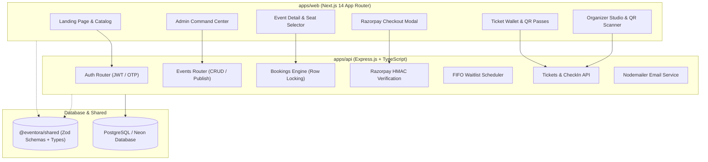

# Eventora — Discover. Connect. Experience.

A sophisticated, editorial full-stack event and workshop discovery platform inspired by the editorial craft of Gather, featuring an original warm ivory and deep forest green visual identity, responsive typography, live seat allocation with concurrency control, Razorpay test mode payment verification, FIFO waitlists, individual QR ticket passes, and staff check-in terminals.

---

## 🏛️ System Architecture



---

## 🎨 Visual Identity & Design System

- **Background Palette**: Warm ivory (`#FAF8F5`, `#F5F2EB`) paired with subtle tactile paper textures.
- **Primary Color**: Deep forest green (`#1A3A2A`, `#142E21`).
- **Accent Color**: Muted terracotta (`#C86446`, `#D97736`).
- **Typography**: Editorial serif headlines (Playfair Display / Georgia) paired with clean sans-serif body text (Plus Jakarta Sans / Inter).
- **Cards & Micro-interactions**: Refined `#E5DFD3` borders, warm layered shadows, aspect-ratio preserved imagery from verified CDN sources, and smooth hover state transitions.

---

## 📁 Monorepo Workspace Structure

```
eventora/
├── apps/
│   ├── api/                     # Express.js + TypeScript REST Backend
│   │   ├── prisma/
│   │   │   ├── schema.prisma    # Normalized PostgreSQL schema with Prisma ORM
│   │   │   └── seed.ts          # Comprehensive seed script (12 events, users, reviews)
│   │   ├── src/
│   │   │   ├── lib/             # Prisma client, JWT, Nodemailer, QRCode utils
│   │   │   ├── middleware/      # Auth (JWT cookie), Role-based access, Zod validator
│   │   │   ├── routes/          # Auth, Events, Bookings, Payments, Tickets, Admin
│   │   │   ├── services/        # Concurrency seat locks, FIFO waitlist scheduler
│   │   │   └── index.ts         # Express server with Helmet, CORS, Rate Limiters
│   │   ├── package.json
│   │   └── tsconfig.json
│   │
│   └── web/                     # Next.js 14 App Router Frontend
│       ├── src/
│       │   ├── app/
│       │   │   ├── page.tsx             # Editorial landing page
│       │   │   ├── events/page.tsx      # Filterable discovery catalog
│       │   │   ├── events/[slug]/       # Event details, booking & waitlist card
│       │   │   ├── login/ & register/   # Authentication flows
│       │   │   ├── forgot-password/     # 6-digit OTP password reset
│       │   │   ├── dashboard/           # Attendee tickets, wallet, waitlists, certs
│       │   │   ├── organizer/           # Organizer studio & html5-qrcode camera scanner
│       │   │   └── admin/               # Admin command center & Recharts analytics
│       │   ├── components/              # Navbar, Footer, EventCard, UI elements
│       │   ├── hooks/useAuth.tsx        # Reactive client authentication state
│       │   └── lib/api.ts               # Type-safe API client with local fallbacks
│       ├── package.json
│       ├── tailwind.config.js
│       └── next.config.js
│
├── packages/
│   └── shared/                  # Monorepo Shared Package
│       ├── src/
│       │   ├── types.ts         # Unified TypeScript interfaces
│       │   ├── schemas.ts       # Zod validation schemas
│       │   └── index.ts
│       ├── package.json
│       └── tsconfig.json
│
├── package.json                 # Monorepo npm workspaces configuration
├── turbo.json                   # Turborepo task pipeline
└── README.md
```

---

## Seed safety

The demo seed deletes existing application data and requires the explicit
`ALLOW_DESTRUCTIVE_SEED=true` opt-in. It also requires unique, 12-character
`ADMIN_PASSWORD`, `SEED_ORGANIZER_PASSWORD`, and `SEED_ATTENDEE_PASSWORD` values.
Never use demo seed credentials in production; the seed does not log passwords.

---

## ⚡ Concurrency & Payment Architecture

### 1. Concurrency-Safe Seat Allocation
Booking uses PostgreSQL transactions combined with row-level locks (`SELECT FOR UPDATE`) on the `Event` entity:
- Prevents race conditions during simultaneous checkout attempts for the final available seat.
- Ensures capacity bounds are never exceeded.

### 2. Razorpay Test Mode Verification
- Server creates Razorpay orders via `@eventora/api`.
- Client checkout opens Razorpay Checkout widget in Test Mode.
- On client return, payment signatures are **cryptographically verified on the backend** using `crypto.createHmac('sha256', RAZORPAY_KEY_SECRET)`:
  $$\text{HMAC-SHA256}(\text{order\_id} \mathbin{\Vert} \text{"|"} \mathbin{\Vert} \text{payment\_id}, \text{secret})$$
- Bookings and tickets are confirmed **only** upon successful HMAC verification.
- Webhook signature reconciliation handles asynchronous background confirmations.

### 3. FIFO Waitlist Management
- When an event sells out (`availableSeats === 0`), attendees can join a FIFO queue.
- When an existing booking is cancelled, seats decrement and `processWaitlist()` automatically promotes the next eligible attendee in line.
- A **2-hour claim window** is granted with real-time countdown timer before expiring and promoting the subsequent attendee.

---

## 🚀 Running the Application Locally

### Prerequisites
- Node.js v18+ or v20+
- PostgreSQL database (or Neon cloud database URL)

### 1. Configure Environment Variables

**Backend (`apps/api/.env`)**:
```env
DATABASE_URL="postgresql://<user>:<password>@<host>/<database>?sslmode=require"
JWT_SECRET="<replace-with-a-random-secret-at-least-32-characters>"
PORT=4000
FRONTEND_URL=http://localhost:3000

# Razorpay Test Mode credentials from your Razorpay dashboard
RAZORPAY_KEY_ID="rzp_test_<your-key-id>"
RAZORPAY_KEY_SECRET="<your-test-key-secret>"
RAZORPAY_WEBHOOK_SECRET="<your-test-webhook-secret>"

# Nodemailer / Gmail SMTP (Optional: Dev mode logs to console if omitted)
SMTP_HOST=smtp.gmail.com
SMTP_PORT=587
SMTP_USER=
SMTP_PASS=
EMAIL_FROM="Eventora <noreply@eventora.com>"

# Default Admin Account
ADMIN_EMAIL=admin@example.com
ADMIN_PASSWORD="<set-a-unique-password>"
ADMIN_NAME="Eventora Admin"
SEED_ORGANIZER_PASSWORD="<set-a-different-unique-password>"
SEED_ATTENDEE_PASSWORD="<set-a-third-unique-password>"
```

**Frontend (`apps/web/.env.local`)**:
```env
NEXT_PUBLIC_API_URL=http://localhost:4000/api
NEXT_PUBLIC_RAZORPAY_KEY_ID=rzp_test_<your-key-id>
NEXT_PUBLIC_APP_NAME="Eventora"
```

### 2. Database Migration & Seed
```bash
npm run db:generate
npm run db:migrate
```

`db:migrate` applies committed migrations and does not reset existing data. The demo seed
deletes all database rows and is blocked unless `ALLOW_DESTRUCTIVE_SEED=true` is set;
use it only with an explicitly disposable database.

### 3. Start Development Servers
From the root workspace:
```bash
# Start API backend (Port 4000)
cd apps/api && npm run dev

# In a separate terminal, start Next.js frontend (Port 3000)
cd apps/web && npm run dev
```

Visit **`http://localhost:3000`** in your browser.

Use the checked-in `.env.example` files as templates and replace placeholders
locally; never commit real environment files. See [DEPLOYMENT.md](./DEPLOYMENT.md)
for Neon, Render, Vercel, production environment variables, and Razorpay webhook
setup.
