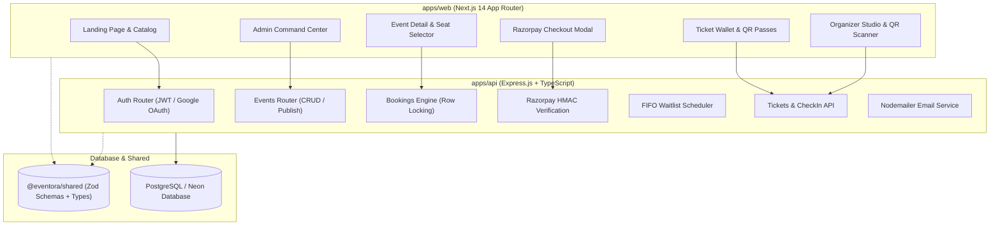

# Eventora — Discover. Connect. Experience.

A sophisticated, editorial full-stack event and workshop discovery platform inspired by the editorial craft of Gather, featuring an original warm ivory and deep forest green visual identity, responsive typography, live seat allocation with concurrency control, Razorpay test mode payment verification, FIFO waitlists, individual QR ticket passes, and staff check-in terminals.

---

## 🏛️ System Architecture



---

## 🎨 Visual Identity & Design System

- **Background Palette**: Warm ivory (`#FAF8F5`, `#F5F2EB`) paired with subtle tactile paper textures.
- **Primary Color**: Deep forest green (`#1A3A2A`, `#142E21`).
- **Accent Color**: Muted terracotta (`#C86446`, `#D97736`).
- **Typography**: Editorial serif headlines (Playfair Display / Georgia) paired with clean sans-serif body text (Plus Jakarta Sans / Inter).
- **Cards & Micro-interactions**: Refined `#E5DFD3` borders, warm layered shadows, aspect-ratio preserved imagery from verified CDN sources, and smooth hover state transitions.

---

## 📁 Monorepo Workspace Structure

```
eventora/
├── apps/
│   ├── api/                     # Express.js + TypeScript REST Backend
│   │   ├── prisma/
│   │   │   ├── schema.prisma    # Normalized PostgreSQL schema with Prisma ORM
│   │   │   └── seed.ts          # Comprehensive seed script (12 events, users, reviews)
│   │   ├── src/
│   │   │   ├── lib/             # Prisma client, JWT, Nodemailer, QRCode utils
│   │   │   ├── middleware/      # Auth (JWT cookie), Role-based access, Zod validator
│   │   │   ├── routes/          # Auth, Events, Bookings, Payments, Tickets, Admin
│   │   │   ├── services/        # Concurrency seat locks, FIFO waitlist scheduler
│   │   │   └── index.ts         # Express server with Helmet, CORS, Rate Limiters
│   │   ├── package.json
│   │   └── tsconfig.json
│   │
│   └── web/                     # Next.js 14 App Router Frontend
│       ├── src/
│       │   ├── app/
│       │   │   ├── page.tsx             # Editorial landing page
│       │   │   ├── events/page.tsx      # Filterable discovery catalog
│       │   │   ├── events/[slug]/       # Event details, booking & waitlist card
│       │   │   ├── login/ & register/   # Authentication flows
│       │   │   ├── dashboard/           # Attendee tickets, wallet, waitlists, certs
│       │   │   ├── organizer/           # Organizer studio & html5-qrcode camera scanner
│       │   │   └── admin/               # Admin command center & Recharts analytics
│       │   ├── components/              # Navbar, Footer, EventCard, UI elements
│       │   ├── hooks/useAuth.tsx        # Reactive client authentication state
│       │   └── lib/api.ts               # Type-safe API client with local fallbacks
│       ├── package.json
│       ├── tailwind.config.js
│       └── next.config.js
│
├── packages/
│   └── shared/                  # Monorepo Shared Package
│       ├── src/
│       │   ├── types.ts         # Unified TypeScript interfaces
│       │   ├── schemas.ts       # Zod validation schemas
│       │   └── index.ts
│       ├── package.json
│       └── tsconfig.json
│
├── package.json                 # Monorepo npm workspaces configuration
├── turbo.json                   # Turborepo task pipeline
└── README.md
```

---

## Seed safety

The demo seed deletes existing application data and requires the explicit
`ALLOW_DESTRUCTIVE_SEED=true` opt-in. It also requires unique, 12-character
`ADMIN_PASSWORD`, `SEED_ORGANIZER_PASSWORD`, and `SEED_ATTENDEE_PASSWORD` values.
Never use demo seed credentials in production; the seed does not log passwords.

---

## ⚡ Concurrency & Payment Architecture

### 1. Concurrency-Safe Seat Allocation
Booking uses PostgreSQL transactions combined with row-level locks (`SELECT FOR UPDATE`) on the `Event` entity:
- Prevents race conditions during simultaneous checkout attempts for the final available seat.
- Ensures capacity bounds are never exceeded.

### 2. Razorpay Test Mode Verification
- The API accepts only complete `rzp_test_` credentials; live keys and placeholder values fail closed.
- Server creates one Razorpay order per pending booking. Retry attempts reuse that same order.
- Client checkout opens Razorpay Checkout with the matching public Test Mode key.
- On client return, the API verifies the signature and fetches Razorpay's payment record to check captured status, order, amount, and currency before confirming tickets:
  $$\text{HMAC-SHA256}(\text{order\_id} \mathbin{\Vert} \text{"|"} \mathbin{\Vert} \text{payment\_id}, \text{secret})$$
- Failed attempts and a dismissed checkout leave the booking pending and can retry the same order.
- Signed `payment.captured` webhooks provide asynchronous confirmation; duplicate captures do not issue duplicate tickets.
- Cancelling a captured paid booking initiates a full refund through Razorpay Test Mode. A payment that is still pending or retryable cannot release its reserved seats.

### 3. FIFO Waitlist Management
- When an event sells out (`availableSeats === 0`), attendees can join a FIFO queue.
- When an existing booking is cancelled, seats decrement and `processWaitlist()` automatically promotes the next eligible attendee in line.
- A **2-hour claim window** is granted with real-time countdown timer before expiring and promoting the subsequent attendee.

---

## 🚀 Running the Application Locally

### Prerequisites
- Node.js v18+ or v20+
- PostgreSQL database (or Neon cloud database URL)

### 1. Configure Environment Variables

**Backend (`apps/api/.env`)**:
```env
DATABASE_URL="postgresql://<user>:<password>@<host>/<database>?sslmode=require"
JWT_SECRET="<replace-with-a-random-secret-at-least-32-characters>"
PORT=4000
FRONTEND_URL=http://localhost:3000

# Razorpay Test Mode credentials from your Razorpay dashboard
RAZORPAY_KEY_ID="rzp_test_<your-key-id>"
RAZORPAY_KEY_SECRET="<your-test-key-secret>"
RAZORPAY_WEBHOOK_SECRET="<your-test-webhook-secret>"

# Nodemailer / Gmail SMTP (Optional: Dev mode logs to console if omitted)
SMTP_HOST=smtp.gmail.com
SMTP_PORT=587
SMTP_USER=
SMTP_PASS=
EMAIL_FROM="Eventora <noreply@eventora.com>"

# Default Admin Account
ADMIN_EMAIL=admin@example.com
ADMIN_PASSWORD="<set-a-unique-password>"
ADMIN_NAME="Eventora Admin"
SEED_ORGANIZER_PASSWORD="<set-a-different-unique-password>"
SEED_ATTENDEE_PASSWORD="<set-a-third-unique-password>"
```

**Frontend (`apps/web/.env.local`)**:
```env
NEXT_PUBLIC_API_URL=http://localhost:4000/api
NEXT_PUBLIC_RAZORPAY_KEY_ID=rzp_test_<your-key-id>
NEXT_PUBLIC_APP_NAME="Eventora"
```

### 2. Database Migration & Seed
```bash
npm run db:generate
npm run db:migrate
```

`db:migrate` applies committed migrations and does not reset existing data. The demo seed
deletes all database rows and is blocked unless `ALLOW_DESTRUCTIVE_SEED=true` is set;
use it only with an explicitly disposable database.

The additive migrations add profile phone numbers, saved events, and in-app notifications,
as well as administrator audit logs, user suspension, review moderation, and support
requests with private internal notes. These migrations are applied to the dedicated local
`eventora_local` database. For any other environment, first confirm `DATABASE_URL` targets
the intended database before applying migrations.

To add only missing production demo login accounts without changing existing users or
passwords, explicitly run:
```bash
npm run db:seed-demo-users -- --apply-production
```
The script prints the database host before writing and saves newly generated logins to
the gitignored `demo-credentials.txt` file. Store that file securely; it contains
plaintext passwords. Existing accounts are preserved and do not have their passwords
reset. This command is separate from the destructive demo seed above.

For the fictional, additive development dataset, first verify the API's
`DATABASE_URL` targets the dedicated local database `eventora_local` on
`127.0.0.1:5433` (or the Compose `postgres:5432` service when seeding in Docker).
The seed also ensures `admin@eventora.com` has the local admin
password supplied through `EVENTORA_LOCAL_ADMIN_PASSWORD`. In PowerShell, enter
that password with a hidden prompt and run the seed from `apps/api`:

```powershell
$securePassword = Read-Host 'Local Eventora admin password' -AsSecureString
$passwordPointer = [Runtime.InteropServices.Marshal]::SecureStringToBSTR($securePassword)
try {
  $env:EVENTORA_LOCAL_ADMIN_PASSWORD = [Runtime.InteropServices.Marshal]::PtrToStringBSTR($passwordPointer)
  npm.cmd run db:seed-demo-dataset
} finally {
  Remove-Item Env:EVENTORA_LOCAL_ADMIN_PASSWORD -ErrorAction SilentlyContinue
  [Runtime.InteropServices.Marshal]::ZeroFreeBSTR($passwordPointer)
}
```

When using Docker Compose, set the same hidden password in the host environment,
then run the seed from the repository root:

```powershell
docker compose --env-file .env.docker exec -T -e "EVENTORA_LOCAL_ADMIN_PASSWORD=$env:EVENTORA_LOCAL_ADMIN_PASSWORD" api npm run db:seed-demo-dataset
```

The local admin password is bcrypt-hashed and is not written to the demo
credentials file. An existing `admin@eventora.com` account keeps its profile and
related records while its password hash and admin role are updated. The seed
creates five organizers, ten attendees, and fifteen events when those records are
missing. Paid demo bookings remain pending; the seed creates no mock payment records.
The seed is local-only, safe to rerun, preserves other users and records, and
never uses the destructive `db:seed` command. Generated demo-user logins are
stored in the gitignored `demo-dataset-credentials.txt` file; keep that file
private.

For ten additional fictional organizer and attendee accounts with related local
development events, registrations, and dashboard data, run from `apps/api`:
```bash
npm run db:seed-organizer-attendee-demo
```
The script refuses production and any database other than `eventora_local` on
`127.0.0.1:5433`, creates missing records only, and preserves existing accounts.
These accounts use the local-only password convention `<FirstName>@1234` (for example,
the password begins with the account holder's first name). The script hashes passwords
with bcrypt and never prints or stores plaintext passwords. Do not reuse these demo
passwords outside local development. Credentials are intentionally excluded from tracked documentation. Keep local demo logins private and never reuse them in production.

To add nine more future-dated, published sample listings without changing existing
records, run this additive seed from the repository root:

```bash
npm run db:seed:demo-events --workspace=@eventora/api
```

It requires the local `eventora_local` database and an existing organizer. It refuses
production and remote database URLs; rerunning it adds only missing categories and
event slugs.

### 3. Start Development Servers
From the root workspace:
```bash
# Start API backend (Port 4000)
cd apps/api && npm run dev

# In a separate terminal, start Next.js frontend (Port 3000)
cd apps/web && npm run dev
```

Visit **`http://localhost:3000`** in your browser.

Use the checked-in `.env.example` files as templates and replace placeholders
locally; never commit real environment files. See [DEPLOYMENT.md](./DEPLOYMENT.md)
for Neon, Render, Vercel, production environment variables, and Razorpay webhook
setup.
